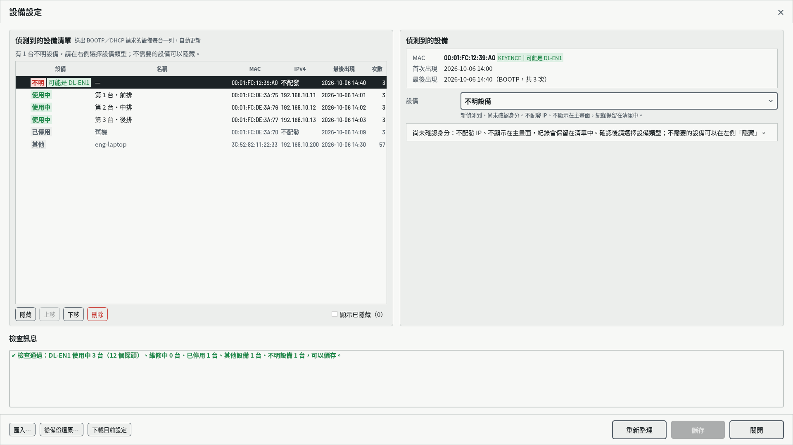
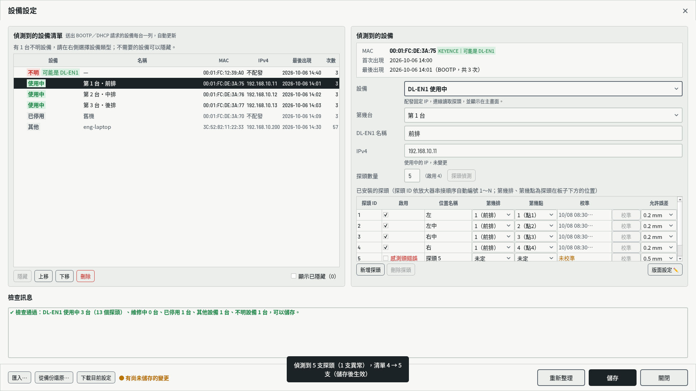
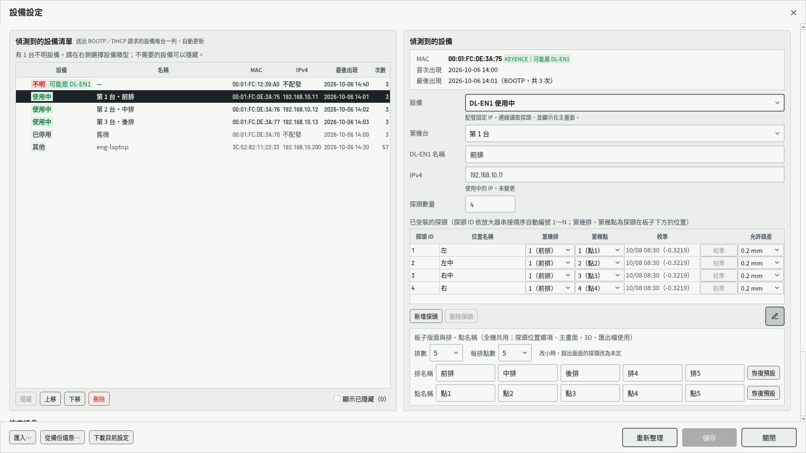
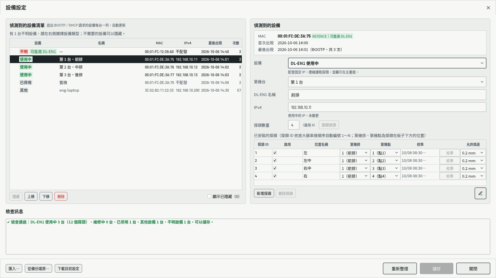
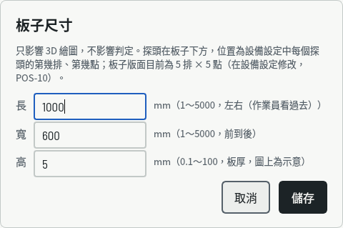

# 表面平整檢查系統 快速安裝指南

| 項目 | 內容 |
| --- | --- |
| 適用版本 | 2026-10-15（repo `main`） |
| 讀者 | 現場安裝的工程人員（需要工程人員密碼） |
| 目的 | 從「電腦已裝好 App」到「量第一片」：設定 DL-EN1 與探頭、板子版面、待測物板子，完成校準與試量測 |
| 詳細說明 | 《操作說明書》第 7～10 章；本指南各步驟後的〔〕為對應章節 |

---

## 流程總覽

| 步驟 | 做什麼 | 在哪裡 | 完成時看到 |
| --- | --- | --- | --- |
| 0 | 準備：接線、標籤、資料庫升級 | 現場、終端機 | 主畫面已開啟 |
| 1 | 加入 DL-EN1，配發 IP | 設備設定 | 清單顯示「使用中」，按過 RST |
| 2 | 探頭偵測，決定啟用哪些探頭 | 設備設定 | 探頭數量等於放大器數量，狀態「正常」 |
| 3 | **板子版面**：幾排、每排幾點 | 設備設定 →「版面設定 ✏️」 | 探頭位置選單只列版面內的排與點 |
| 4 | 每個探頭的第幾排、第幾點 | 設備設定 | 「未設定位置」區是空的 |
| 5 | **待測物板子**：長、寬、高 | 主畫面「板子 … mm」 | 按鍵顯示新的尺寸 |
| 6 | 用標準件逐一校準 | 設備設定 →「校準」 | 每個探頭都有校準時間 |
| 7 | 試量測、驗收 | 主畫面 | 標準件各點在 0 ± 0.002 mm，結果「合格」 |

> **為什麼是這個順序**
> - 「版面設定 ✏️」在探頭清單下方，要先有一台 DL-EN1 才看得到。
> - 「探頭偵測」要連到 DL-EN1，所以 DL-EN1 必須先取得 IP（步驟 1）。
> - 板子版面決定探頭位置能選哪些排與點，所以要在設定探頭位置（步驟 4）之前。
> - 步驟 2～4 可以在同一次設定中做完，最後一起「儲存」。
> - 沒校準的探頭一律判「設備異常：未校準」，所以步驟 6 不能省略。

---

## 步驟 0　準備

**需要的東西**：工程人員密碼、標準件（golden sample）、量板子用的尺、標籤紙。

1. **接線**：
   - DL-EN1 接到電腦的**設備網路**（eno2，192.168.10.1/24），不要接公司網路。
   - GT2 放大器在 DL-EN1 上由左至右串接，**串接順序就是探頭 ID 1、2、3…**，無法自己指定。
   - 每個放大器接好感測頭，再上電。
2. **貼標籤**：在每支感測頭的線上貼「第 N 台－ID k」，例如「1-2」。DL-EN1 只知道 ID、分不出線有沒有接錯，日後更換和查錯都靠這張標籤。
3. **放大器面板開啟按鍵鎖定**：避免歸零被人在面板上改掉（系統無法自動發現）。步驟 6 校準若出現「放大器設定失敗」，先暫時解除鎖定。
4. **資料庫升級**（新安裝或更新程式後執行一次，可以重複執行）：
   ```
   cd ~/in-win
   sudo mysql < sql/in-win.sql
   ```
   沒執行時，板子版面等設定會存不進去，畫面會提示要執行這一行。
5. **App 要開著**：DL-EN1 是向 App 要 IP 的，App 關閉時新上電的 DL-EN1 拿不到 IP。
6. DL-EN1 同一時間只接受一條連線：KEYENCE 的設定軟體要先關掉。

✔ **完成**：主畫面已開啟；新的 DL-EN1 還沒設定，所以主畫面還不會出現它的探頭。〔操作說明書 2.1、11.4〕

---

## 步驟 1　加入 DL-EN1，配發 IP



1. 按主畫面右上角的**鉛筆鍵**，輸入工程人員密碼。
2. 清單最上面出現紅色「不明」並標示「可能是 DL-EN1」的那一列，就是新的 DL-EN1。用 MAC 對照機身標籤確認是哪一台。
3. 選取它，右邊「設備」改為「**DL-EN1 使用中**」。系統會帶入：
   - 第幾台：最小的空號。
   - IPv4：192.168.10.11～.99 中最小的空位址。
4. 依現場修改「第幾台」「DL-EN1 名稱」（1～10 個字，例如「前沿」）。
5. 按「**儲存**」→ 核對確認畫面 →「**確認儲存**」。
6. **按住這台 DL-EN1 上的 RST 鍵 3 秒**。DL-EN1 會記住舊的 IP，斷電重開不會換 IP，只有按 RST 才會重新要 IP。

有好幾台 DL-EN1 時，可以全部設好再一次儲存，然後逐台按 RST。

✔ **完成**：清單中這台顯示綠色「使用中」與新的 IP；回主畫面後，偵測設備不再顯示「偵測不到」。

✘ **一直在「不明」或偵測不到**：檢查網路線是否接在設備網路、App 是否開著、RST 是否按滿 3 秒。〔操作說明書 7.4、10.1〕

---

## 步驟 2　探頭偵測與啟用



1. 在設備設定選取這台 DL-EN1，按「探頭數量」旁的「**探頭偵測**」。系統只讀取、不寫入。
2. 清單依實際串接的放大器數量自動增減，每列「啟用」旁邊顯示狀態：
   - **正常**：預設勾選啟用。
   - **感測頭錯誤**（紅字）：感測頭沒接好或故障，預設不啟用。接好後再按一次「探頭偵測」。
3. 決定要使用哪些探頭：
   - 會量測的：勾選「啟用」。
   - 有接但這次不用、或壞掉的：取消勾選。**不要刪除中間的探頭**，ID 是由放大器的位置決定的，刪除會讓後面每支的設定都對錯一格。
4. 「位置名稱」可以直接改成現場的叫法，例如「左前」。

✔ **完成**：「探頭數量」等於放大器數量，旁邊顯示「（啟用 M）」；要用的探頭狀態都是「正常」。

✘ **「偵測不到第 N 台」**：步驟 1 的 RST 還沒按，或 IP 還沒生效。✘ **數量比實際少**：檢查放大器之間的連接器是否接緊。〔操作說明書 7.5〕

---

## 步驟 3　板子版面



1. 按探頭清單下方最右邊的「**版面設定 ✏️**」，打開「板子版面與排、點名稱」區塊。
2. 依板子下方探頭的實際排列，選「**排數**」與「**每排點數**」（各 1～5）：
   - 排：由前到後。
   - 點：由左到右。
   - 例：板子下方前、後各 3 支探頭 → 2 排 × 3 點。
3. 需要時改排名稱、點名稱（例如「前排」「後排」），主畫面、3D 與匯出的 Excel 都會用這些名稱。
4. 版面是全機共用的，選哪一台 DL-EN1 看到的都是同一組。

✔ **完成**：探頭的「第幾排」「第幾點」選單只列出版面內的值。

> 注意：之後把版面改小時，超出新版面的探頭會自動改為「未定」，存檔前的確認畫面會列出它們。版面只有 1 排或 1 點時，3D 繪圖無法使用（仍可儲存）。〔操作說明書 7.5〕

---

## 步驟 4　探頭位置



1. 為每個**啟用**的探頭選「第幾排」「第幾點」，兩個都要選。
   - 已被其他探頭佔用的點會變灰，不能選。
   - 位置名稱還是預設「探頭 N」時，會自動改成點的名稱。
2. 不同台 DL-EN1 的探頭可以放在同一排，位置只看探頭實際裝在板子下方哪裡，與接在哪一台無關。
3. 檢查訊息出現綠色「✔ 檢查通過」後，按「**儲存**」→ 核對 →「**確認儲存**」。

✔ **完成**：主畫面依版面排列，每排方塊上下對齊；最下方的黃色「未設定位置」區不再出現。

> 建議：在板子上逐點輕壓探頭，看主畫面哪一格的讀值變動，確認接線與位置一致（DL-EN1 無法發現兩條感測頭線對調）。〔操作說明書 3.3、7.4〕

---

## 步驟 5　待測物板子



1. 回到主畫面，按頂端工具列的「**板子 1000×600×5 mm**」（顯示目前的尺寸）。不需要密碼。
2. 輸入待測物的**長、寬、高**（mm，可到小數 1 位；長、寬 1～5000，高 0.1～100）。
   - 長：沿「點」的方向（由左到右）。
   - 寬：沿「排」的方向（由前到後）。
3. 按「儲存」，立即生效，重新開機後保留。

✔ **完成**：按鍵顯示新的尺寸；視窗說明列出目前的板子版面（例如 2 排 × 3 點）。

> 板子尺寸只影響 3D 繪圖的比例與探頭在圖上的位置，不影響合格判定。〔操作說明書 5.5〕

---

## 步驟 6　探頭校準

1. 進入設備設定，選取這台 DL-EN1。這台必須**已經儲存、沒有未儲存的修改**，否則「校準」鍵不能按。
2. 把**標準件**放上治具，放穩之後不要再碰。
3. 按某個探頭那一列的「**校準**」→「**開始校準**」。一次校準一個探頭，每個約數秒。
4. 看到「✔ 驗證通過」後，校準欄會顯示校準時間；接著校準下一個探頭。
5. 所有**啟用**的探頭都要校準。未啟用的探頭不用。

| 結果 | 處理方式 |
| --- | --- |
| ✘ 讀值不穩定 | 標準件沒放穩或治具晃動，放穩後重做 |
| ✘ 驗證未通過 | 驗證過程中被碰到，重做 |
| ✘ 放大器設定失敗 | 放大器拒絕寫入。原本的歸零不變。若面板開了按鍵鎖定，先暫時解除、校準完再鎖上 |

✔ **完成**：每個啟用的探頭都有校準時間，沒有橘色「未校準」。〔操作說明書第 8 章〕

---

## 步驟 7　試量測與驗收

1. 回到主畫面，等結果橫幅顯示「**待放置**」。
2. **標準件驗收**：放上標準件，按「**下一片**」。每一點的讀值都要在 **0 ± 0.002 mm** 內。超出的點重新校準。
3. **實際試量**：放一片已知好壞的板子，按「下一片」，確認結果和預期相同。
4. 按「3D 繪圖」，確認凹凸的位置和板子實際的位置一致（左右、前後沒有相反）。
5. 按「取出測試數據」，匯出今天的 Excel，確認有剛才的紀錄。

✔ **完成**：可以交給作業員量產。之後每班開工、或更換治具後，都放上標準件按一次「下一片」檢查（同第 2 點）。〔操作說明書第 4～6 章、8.3〕

---

## 常見狀況

| 畫面 | 原因 | 處理方式 |
| --- | --- | --- |
| 設備異常「未校準」 | 新增或啟用的探頭還沒校準 | 步驟 6 |
| 頂端提示「偵測到 N 支、設定 M 支，請在設備設定按『探頭偵測』」 | 放大器比設定的多 | 步驟 2；已設定的探頭仍照常量測 |
| 探頭「感測頭錯誤」 | 感測頭沒接好或故障 | 接好後重新偵測；暫時不用就取消啟用 |
| 某台「偵測不到」 | 網路線、電源，或 RST 還沒按 | 檢查接線，按 RST 3 秒；送修時把設備改為「維修中」，其他台可以照常量測 |
| 儲存時提示「資料庫還沒有升級」 | 沒有執行步驟 0 的資料庫升級 | 執行 `sudo mysql < sql/in-win.sql` 後再儲存一次 |
| 3D 繪圖無法開啟 | 有探頭沒設定位置、有效點少於 3 個，或全部在同一直線上 | 步驟 3、4 |

---

## 安裝紀錄表

安裝完成後填寫，與設備一起保存。

| 項目 | 內容 |
| --- | --- |
| 安裝日期／人員 | |
| 板子版面 | ＿＿ 排 × ＿＿ 點 |
| 板子尺寸（長 × 寬 × 高 mm） | |
| 標準件編號 | |

| 第幾台 | DL-EN1 名稱 | MAC | IPv4 | 探頭數（啟用） | 校準完成時間 | 標準件驗收（最大偏差 mm） |
| --- | --- | --- | --- | --- | --- | --- |
| 1 | | | | | | |
| 2 | | | | | | |
| 3 | | | | | | |

| 第幾台－ID | 位置名稱 | 第幾排 | 第幾點 | 線上標籤已貼 |
| --- | --- | --- | --- | --- |
| | | | | ☐ |
| | | | | ☐ |
| | | | | ☐ |
| | | | | ☐ |
| | | | | ☐ |
| | | | | ☐ |
